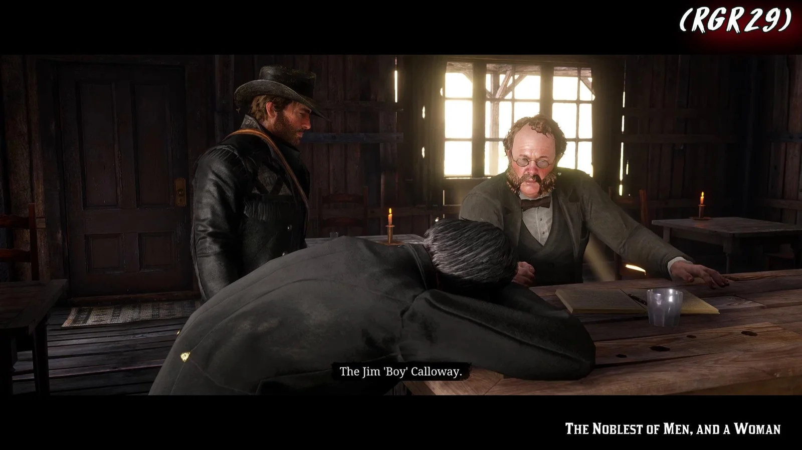
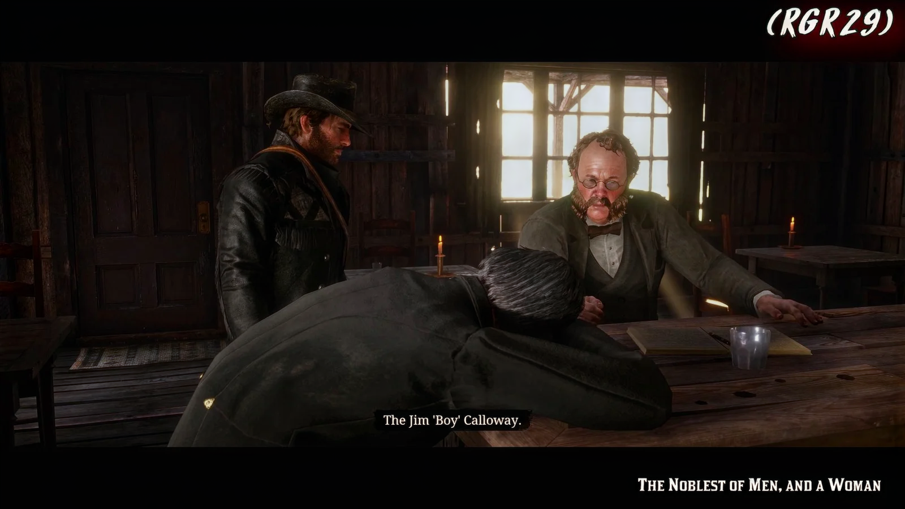

# YaNR

YaNR 是一个神经渲染（Neural Rendering，NR）学生模型蒸馏与推理项目。项目以
OpenDLSS-NR 的教师网络为参考，训练计算量更小的学生模型，并提供独立的 C++ CPU / CUDA GPU
推理引擎，可直接读取图片、加载学生权重包并输出 NR 结果。

项目包含教师与学生的 Python 实现、蒸馏训练与数值校验工具，以及支持 AVX2、INT8
和 VNNI 的 C++17 / OpenMP 引擎，以及 Windows NVIDIA CUDA 后端。
C++ 图片推理不需要 Python、PyTorch 或 OpenCV。

## 效果展示

下面展示仓库中 `teacher/samples/t1` 到 `teacher/samples/t6` 保存的原图与 NR 结果。
点击图片可查看原始分辨率。示例目录没有记录生成时的权重版本和条件参数。

### t1 · 1600 × 900

| 原图 | NR 结果 |
| :---: | :---: |
| [](teacher/samples/t1/t1.png) | [](teacher/samples/t1/nr.png) |

### t2 · 960 × 540

| 原图 | NR 结果 |
| :---: | :---: |
| [](teacher/samples/t2/t2.png) | [](teacher/samples/t2/nr.png) |

### t3 · 1920 × 1080

| 原图 | NR 结果 |
| :---: | :---: |
| [](teacher/samples/t3/t3.png) | [](teacher/samples/t3/nr.png) |

### t4 · 736 × 1250

| 原图 | NR 结果 |
| :---: | :---: |
| [](teacher/samples/t4/t4.png) | [](teacher/samples/t4/nr.png) |

### t5 · 1920 × 1080

| 原图 | NR 结果 |
| :---: | :---: |
| [](teacher/samples/t5/t5.png) | [](teacher/samples/t5/nr.png) |

### t6 · 1080 × 669

| 原图 | NR 结果 |
| :---: | :---: |
| [](teacher/samples/t6/t6.png) | [](teacher/samples/t6/nr.png) |

## 快速开始：C++ 图片推理

以下命令在仓库根目录执行。Windows 构建需要 Visual Studio C++ 工具链和 CMake；
图片解码使用系统 WIC，支持 PNG、JPEG、BMP 和中文路径。

```powershell
cmake -S engine -B engine/build -DNR_AVX2=ON -DNR_VNNI=ON
cmake --build engine/build --config Release -j 8
```

权重需要单独准备，`weights/` 不随源码提交。支持的学生权重包结构为：

```text
weights/student_moe_v0/
├── manifest.json
├── shape.json
└── model/
    └── stages/
        ├── s0.bin
        ├── s1.bin
        └── s2.bin
```

指定图片、权重和输出路径即可推理：

```powershell
engine/build/Release/cpu_engine.exe teacher/samples/lake.png `
    --weights weights/student_moe_v0 `
    -o out/lake_nr.png
```

不传尺寸时保持输入图片尺寸；`--size 512` 缩放为 512 × 512，
`--width 512 --height 320` 指定非方形尺寸。不传 `-o` 时输出为输入图片旁的
`<文件名>_nr.png`。

引擎默认权重路径为 `weights/student_mixed`。使用新版 MoE 模型时需显式指定
`--weights weights/student_moe_v0`。

### Windows GPU 加速（NVIDIA CUDA）

安装 NVIDIA 驱动和 CUDA Toolkit，并在 **x64 Native Tools Command Prompt for VS 2022**
中进入仓库根目录构建。CUDA 编译器与 MSVC 工具集需兼容；本机已验证 CUDA 12.4 + MSVC 14.38。
这个构建使用独立目录，生成 `gpu_engine.exe`：

```bat
cmake -S engine -B engine/build-cuda -G "NMake Makefiles" -DCMAKE_BUILD_TYPE=Release -DNR_CUDA=ON
cmake --build engine/build-cuda --target gpu_engine cpu_engine
```

回到 PowerShell 即可运行，CUDA 的 `bin` 目录需在 `PATH` 中：

```powershell
engine/build-cuda/gpu_engine.exe teacher/samples/lake.png `
    --weights weights/student_moe_v0 --size 512 `
    --bench --warmup 10 --repeats 50 -o out/lake_gpu_nr.png
```

直接读取同一份学生权重包，无需转换。`gpu_engine` 默认 CUDA，
CUDA 构建中的 `cpu_engine --backend cuda` 也能启用 GPU；`--device 0` 选择显卡。
图片参数与 CPU 入口相同。网络前向（包括 MoE 配额平衡路由）在 GPU 执行，
复用驻留权重与 CUDA Graph；图片解码、lane 构造和 PNG 合成仍由 C++ CPU 完成。

测速用 CUDA event 统计完整 GPU 前向，排除预热、Graph 构建和主机/显卡传输，
H2D / D2H 单独打印。当前使用 FP32，关闭 TF32；INT8/VNNI 参数用于 CPU 后端。
完整构建说明、测速与数值对账见 [引擎文档](engine/README.md)。

2026-10-13 本机 RTX 3080 / i9-10900K 实测，FP32、CPU 8 线程、10 次预热、50 次测量，
输入 `lake.png`、style 0；Windows 桌面应用在运行。只统计网络前向，传输和图片处理另计：

| 模型 | 有效尺寸（field） | CPU median | CUDA median | 加速 |
| --- | --- | ---: | ---: | ---: |
| `student_mixed` | 320×320（320×320） | 28.143 ms | 4.923 ms | 5.7× |
| `student_mixed` | 512×512（576×512） | 80.180 ms | 11.177 ms | 7.2× |
| `student_moe_v0` | 320×320（320×320） | 84.497 ms | 8.374 ms | 10.1× |
| `student_moe_v0` | 512×512（576×512） | 228.584 ms | 17.276 ms | 13.2× |

### 模型选择

| 权重包 | 参数量 | 特点 |
| --- | ---: | --- |
| `student_mixed` | 4,286,790 | 较小、CPU 推理较快；旧模型的 style 训练范围为 `0..3` |
| `student_moe_v0` | 62,831,273 | 全级 top-1 MoE，每块 8 个专家；支持窗口与 ViT token 路由，style 按 `0..127` 全量程训练 |

MoE 每个窗口或 token 只选择一个专家，但权重体积和推理耗时仍大于旧模型。
模型与训练结果详见 [v2.0 验收报告](teacher/report_v2.md)。

### 图片入口参数

| 参数 | 默认值 | 含义 |
| --- | --- | --- |
| `--weights PATH` | `weights/student_mixed` | 学生权重包目录 |
| `-o PATH` / `--png PATH` | `<文件名>_nr.png` | NR 输出图片 |
| `--size N` | 输入尺寸 | 缩放为 N × N |
| `--width W --height H` | 输入尺寸 | 分别指定宽、高 |
| `--style S` | `64` | style ID / 条件值，范围 `0..127`，输入 lane 为 `S / 128` |
| `--tone T` | `1` | tone 条件值，通常使用 `0..1` |
| `--structure S` | `1` | structure 条件值，通常使用 `0..1` |
| `--skin S` | `1` | 自动 mask 开启时生效；负值跟随 structure |
| `--automask` / `--no-automask` | 开启 | 启用 / 关闭自动 mask 条件分支 |
| `--seed N` | `12345` | 噪声输入 seed，同输入与参数可重复得到相同结果 |
| `--threads N` | 环境变量或 `8` | OpenMP 线程数，可覆盖 `OMP_NUM_THREADS` |
| `--backend cpu\|cuda` | `cpu_engine`: CPU；`gpu_engine`: CUDA | 选择前向后端，CUDA 需启用 `NR_CUDA` 构建 |
| `--device N` | `0` | CUDA 显卡编号 |

CPU/GPU 图片入口和 C++ `LaneParams` 默认均为 `style=64、tone=1、structure=1、skin=1、automask=开启`。
参数可显式覆盖，`--no-automask` 关闭自动 mask。

`style` 是网络的条件输入，效果不保证随数值线性增强。旧 `student_mixed` 可显式指定
`--style 0` 或其他 `0..3` 范围内的值；使用较大的
style 值可能出现背景噪声、颜色溢出或结构伪影；需要全量程条件时使用 `student_moe_v0`。

静态单图的历史输入 lane 使用当前原图，输出按
`clamp(proxy + head_rgb / 4, 0, 1)` 合成，首帧不额外应用时序融合。
使用 `--features` 输入预先生成的 lane 时，命令行条件参数不会重新构造它们。

## 前向性能

`--bench` 只测 `Engine::forward`，预热、权重加载与打包、图片解码与缩放、输入 lane
构建、RGB 合成和 PNG 写入均不计入前向时间。

```powershell
engine/build/Release/cpu_engine.exe teacher/samples/lake.png `
    --weights weights/student_moe_v0 --size 512 --threads 8 `
    --style 0 --tone 0.5 --structure 0.5 --skin -1 --no-automask `
    --bench --warmup 10 --repeats 30 -o out/lake_bench.png
```

以下为已记录的本机 FP32 测量：i9-10900K、MSVC Release /O2、AVX2、8 个 OpenMP 线程，
输入为 `teacher/samples/lake.png`，预热 10 次；`student_mixed` 测量 50 次，MoE 测量
30 次。这些是缩放后的测试尺寸，不能当作上方原尺寸示例的耗时。

| 模型 | 有效尺寸 | 实际 field | median | p90 |
| --- | --- | --- | ---: | ---: |
| `student_mixed` | 320 × 320 | 320 × 320 | 23.868 ms | 27.688 ms |
| `student_mixed` | 512 × 512 | 576 × 512 | 65.274 ms | 75.091 ms |
| `student_moe_v0` | 320 × 320 | 320 × 320 | 80.836 ms | 90.004 ms |
| `student_moe_v0` | 512 × 512 | 576 × 512 | 232.554 ms | 245.718 ms |

默认使用 FP32。`NR_INT8=1` 可启用混合 INT8；构建时开启 `NR_VNNI=ON` 后，引擎会按
CPU 与系统支持情况选择 AVX-VNNI、AVX-512 VNNI 或回退后端。当前测量机器的 INT8
使用 AVX2，耗时高于 FP32；VNNI 的真实性能需要在支持该指令的机器上测量。
完整计时口径、INT8 数据和数值对账见 [C++ 引擎文档](engine/README.md)。

## 校验与开发

```powershell
ctest --test-dir engine/build -C Release --output-on-failure
```

测试覆盖 GEMM、FFN、MoE 分组与少行尾块、残差、field 操作及 INT8 / VNNI 内核。
MoE C++ 前向与 Python 参考在相同输入下对账，320 / 512 的 head 最大误差分别约为
`5.7e-6` / `6.7e-6`。

需要 Python 训练或校验时，使用 uv 创建环境，再按
[teacher 文档](teacher/README.md) 配置所需依赖与权重：

```powershell
uv venv .venv --python 3.10
```

## 项目结构

| 路径 | 内容 |
| --- | --- |
| [engine/](engine/README.md) | C++ CPU / CUDA GPU 推理、图片入口、AVX2 / INT8 / VNNI 内核与 benchmark |
| [teacher/](teacher/README.md) | 教师和学生网络、蒸馏训练、时序管线、数值与质量校验 |
| [teacher/samples/](teacher/samples/) | 输入图片与效果示例 |
| [shapes/](shapes/) | 学生网络形状配置 |
| [openspec/specs/](openspec/specs/) | 网络、训练、评估、打包和 CPU 引擎规格 |
| [teacher/STUDENT.md](teacher/STUDENT.md) | 学生架构与设计说明 |
| `weights/` | 本地权重包，独立准备，不随源码提交 |

教师实现的来源、数值契约与验证方式见 [teacher README](teacher/README.md)。
